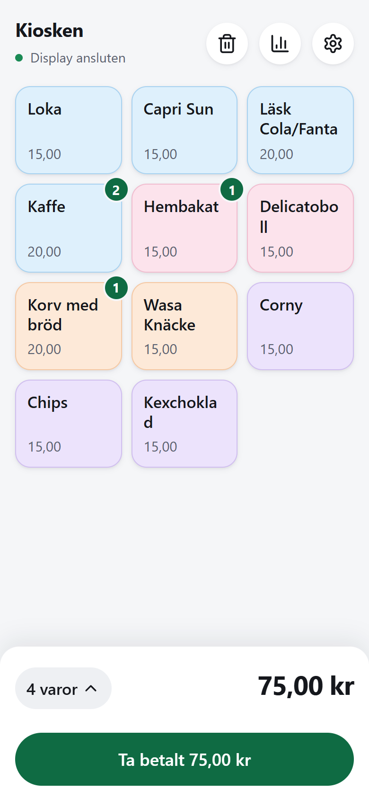
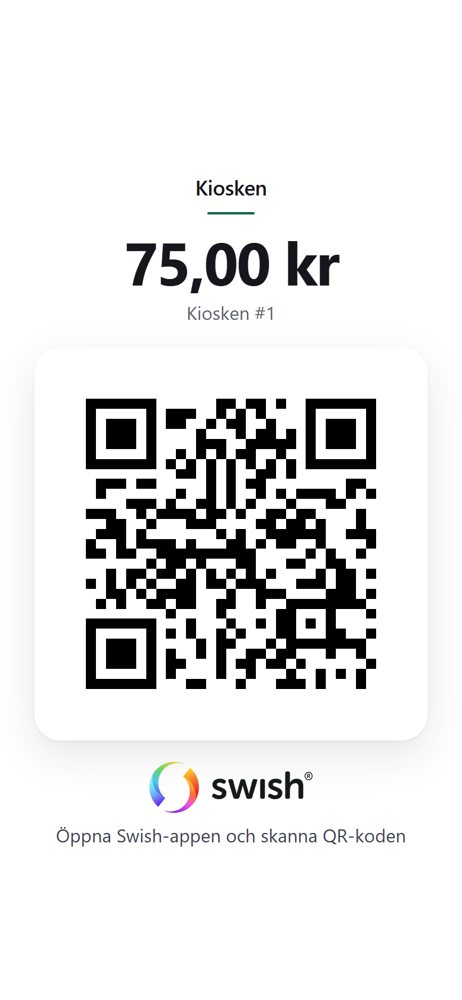
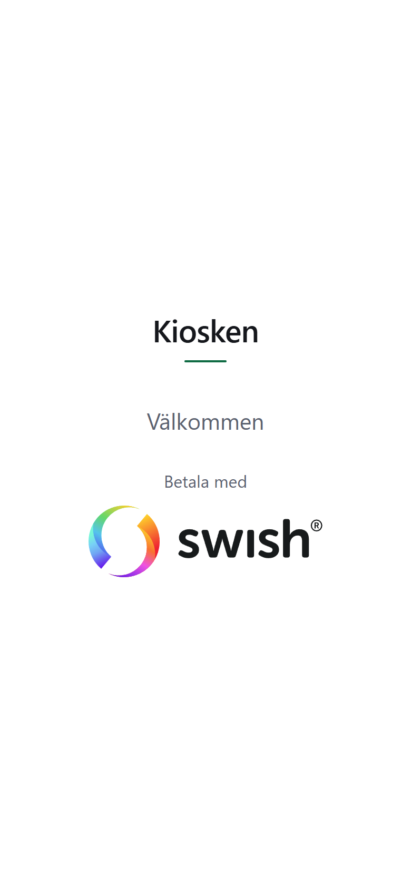

# Swish-kassa

**Svenska** · [English](README.en.md)

En enkel kassa för kiosken, marknadsståndet eller föreningscaféet, med två mobiler och
Swish.

Du trycker in det kunden köper på din egen mobil. En andra mobil står vänd mot kunden
och visar en Swish-QR-kod med exakt belopp. Kunden skannar koden, och Swish-appen
öppnas med ditt nummer, beloppet och ett meddelande redan ifyllda. Ingen kortläsare,
inget abonnemang och ingen app att ladda ner.

<p align="center">
  
  &nbsp;&nbsp;
  
</p>
<p align="center"><sub>Till vänster: din mobil, kassan. Till höger: kundens skärm. (Testdata.)</sub></p>

## Det här behöver du

- **Två mobiler.** En till dig och en till kunden. Kundens mobil kan vara en gammal som
  ligger i en låda: den behöver bara en webbläsare och wifi eller mobildata.
- **Ett Swish-nummer** som kan ta emot betalningar.
- **Ett gratis konto på [GitHub](https://github.com/signup)** och **ett gratis konto på
  [Cloudflare](https://dash.cloudflare.com/sign-up).** Kassan körs hos Cloudflare, och
  GitHub sparar din kopia av den. Du behöver inte kunna något om dem: du klickar dig
  bara igenom stegen nedan en gång. Deras sidor är på engelska.

Det kostar ingenting att köra. Cloudflares gratisnivå räcker med god marginal för en
kiosk.

## Steg 1: Skaffa din egen kassa

Klicka på knappen:

[](https://deploy.workers.cloudflare.com/?url=https://github.com/kjez66/swish_calculator)

1. Logga in på Cloudflare (eller skapa kontot) när du blir ombedd.
2. Koppla ditt GitHub-konto när du blir ombedd. Cloudflare lägger din egen kopia av
   kassan där.
3. Låt de föreslagna namnen vara som de är och klicka på **Create and deploy**.
4. Vänta ett par minuter. När det är klart visar Cloudflare kassans adress. Den ser ut
   ungefär som `https://swish-kassa.ditt-namn.workers.dev`. **Skriv upp den.** Det är
   din kassa.

Kassan är bara din: den körs i ditt Cloudflare-konto, och din försäljning sparas där,
inte hos någon annan. Om andra öppnar din adress får de var sin egen kassa och kan inte
se din.

## Steg 2: Ställ in din mobil (kassan)

1. Öppna kassans adress på din mobil.
2. **Lägg den på hemskärmen**, så att den öppnas som en app:
   - **Android (Chrome):** menyn (⋮) → **Installera app** (eller **Lägg till på
     startskärmen**).
   - **iPhone (Safari):** dela-knappen (□↑) → **Lägg till på hemskärmen**. Öppna sedan
     kassan från den nya ikonen och gör resten av inställningarna där. På en iPhone
     delar appen på hemskärmen ingenting med Safari, så en kassa som du har ställt in i
     Safari finns inte i appen.
3. Tryck på kugghjulet (⚙) för att öppna inställningarna:
   - **Butiksnamn:** ståndets namn. Det visas för kunden och står i meddelandet på
     varje betalning.
   - **Swish-nummer:** numret som pengarna ska till.
   - **Produkter:** dina varor och priser. En ny kassa har en exempelmeny; ändra den, ta
     bort det du inte säljer och lägg till dina egna. **Aktiv** döljer en vara i kassan
     utan att ta bort den, för när något tar slut.
4. Tryck på **Spara**.

## Steg 3: Ställ in kundens mobil (displayen)

1. Tryck på **Ingen display** högst upp i kassan på din mobil. En QR-kod och en
   sexsiffrig kod visas.
2. Skanna QR-koden med kameran på kundens mobil. Displayen öppnas och kopplar upp sig
   mot din kassa av sig själv. (Eller öppna kassans adress följd av `/display`, till
   exempel `https://swish-kassa.ditt-namn.workers.dev/display`, och skriv in koden.)
3. Din mobil visar nu **Display ansluten**. Det här gör du bara en gång.
4. Lägg gärna displayen på hemskärmen också, på samma sätt som kassan, så öppnas den i
   helskärm. På en iPhone gör du det innan du kopplar ihop, och skriver in koden i
   appen.
5. På kundens mobil: **skruva upp ljusstyrkan till max, stäng av automatisk ljusstyrka
   och ställ in skärmen så att den aldrig släcks.** En mörk skärm utomhus är den
   vanligaste anledningen till att en QR-kod inte går att skanna.

<p align="center">
  
</p>
<p align="center"><sub>Mellan kunderna visar displayen ståndets namn och ”Betala med Swish”.</sub></p>

## Sälja

1. Tryck på varorna som kunden vill ha. Tryck igen för fler av samma. Summan står
   längst ner; tryck på antalet varor för att se listan och ändra i den.
2. Tryck på **Ta betalt**. QR-koden visas på kundens skärm.
3. Kunden skannar den med Swish-appen och betalar.
4. **Kontrollera i din egen Swish-app att pengarna har kommit in.** Tryck sedan på
   **Klar**. Kundens skärm tackar, och köpet sparas.

**Avbryt** stänger betalningen utan att spara något och behåller varorna, för ”vänta,
jag tar en bulle också”. Papperskorgen tömmer hela varukorgen.

## Efter dagen

Diagramknappen (📊) visar försäljningen för varje dag: antal köp, summan, hur mycket
som sålts av varje vara och varje köp med klockslag. **Ladda ner PDF** sparar en
rapport på en sida att lämna in. Jämför summan med din Swish-app.

Försäljningen sparas i 31 dagar och tas sedan bort automatiskt.

## Bra att veta

- **Kassan kan inte se om kunden har betalat.** Swish berättar inte det för den.
  ”Klar” betyder att *du* har sett pengarna komma in i din egen Swish-app. Kontrollera
  alltid innan du trycker.
- **Gör ett testköp före den första riktiga försäljningen.** Gör ett litet köp, skanna
  koden med din egen Swish-app och kontrollera att numret, beloppet och meddelandet
  stämmer. Du kan avbryta i Swish-appen utan att betala.
- **Kassan bor i din mobils webbläsare.** Det finns ingen inloggning. Om du rensar
  webbläsarens data eller byter mobil glömmer mobilen kassan och börjar om med en ny,
  tom kassa, och den gamla försäljningen går inte att få tillbaka. En iPhone kan också
  glömma den om du inte öppnar den på en vecka. Att lägga kassan på hemskärmen gör det
  mycket mindre troligt. Om det händer: fyll i inställningarna igen och koppla ihop
  displayen igen (steg 3).
- **Vilket Swish-nummer?** Kassan tar både privat Swish (börjar med 07) och Swish för
  företag och föreningar (börjar med 123). Kontrollera att ditt Swish-avtal tillåter
  den sortens försäljning du har.
- **Nya versioner:** din kopia ändras inte när det här projektet ändras, så inget
  ändras mitt under en försäljning.

## För utvecklare

Kräver Node.js 22 eller senare.

```bash
npm install
npm run dev       # http://localhost:8787 i den riktiga Workers-miljön
npm test          # alla tester, i Workers-miljön
npm run check     # lint och formatering (Biome); npm run format rättar formateringen
npm run deploy    # driftsätt till ditt Cloudflare-konto (kör npx wrangler login först)
```

Allt är vanlig HTML, CSS och JavaScript utan byggsteg. En Cloudflare Worker skickar
`/api/*` vidare till Durable Objects: en per kassa (inställningar, varor, försäljning
och den direkta WebSocket-anslutningen till displayen) och en gemensam katalog för
kopplingskoder och begränsning av antal anrop. Kundens display (`public/display.js`)
hålls i ES5 så att den fungerar på gamla mobiler; ett test ser till det.

| Sökväg | Vad |
|---|---|
| `public/` | De två sidorna, som statiska filer: `index.html` och `app.js` (kassan), `display.html` och `display.js` (kundens display) |
| `public/shared/` | Kod för belopp, Swish-QR-innehåll, försäljningssammanställning och PDF-rapport, delad med servern |
| `public/_headers` | Säkerhetshuvuden för de statiska filerna |
| `src/` | Worker och Durable Objects |
| `src/defaults.js` | Exempelmenyn som en ny kassa börjar med |
| `tests/` | Tester, körs med `npm test` |
| `wrangler.jsonc` | Cloudflare-inställningar |

Formatet för QR-kodens innehåll är dokumenterat av användare, inte publicerat av
Getswish. Testerna visar att appen skapar den text den ska, men inte att Swish godtar
den; det är testköpet ovan som visar det.

## Licens

MIT, se [`LICENSE`](LICENSE). Namnet Swish och Swish-logotypen tillhör Getswish AB och
omfattas inte av licensen; Lucide-ikonerna har sin egen licens. Se
[`THIRD_PARTY_NOTICES.md`](THIRD_PARTY_NOTICES.md).
